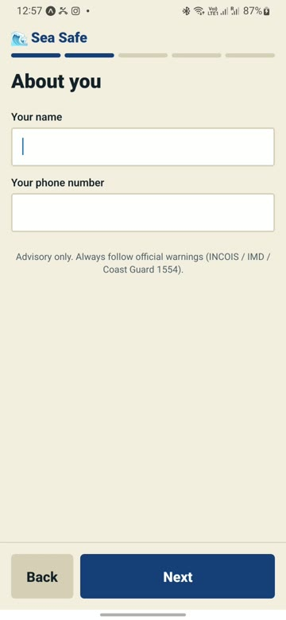
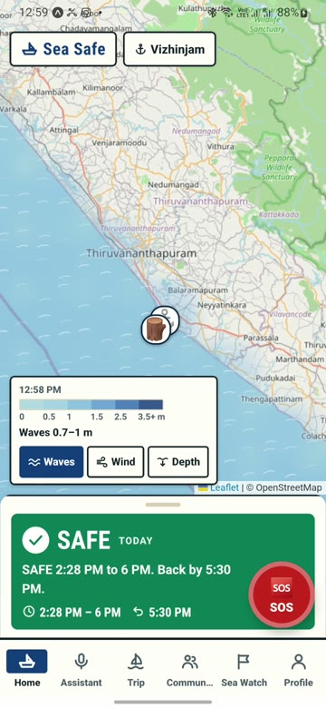
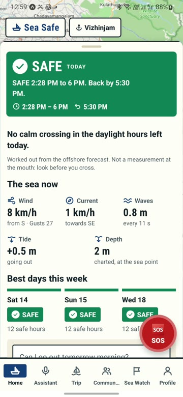
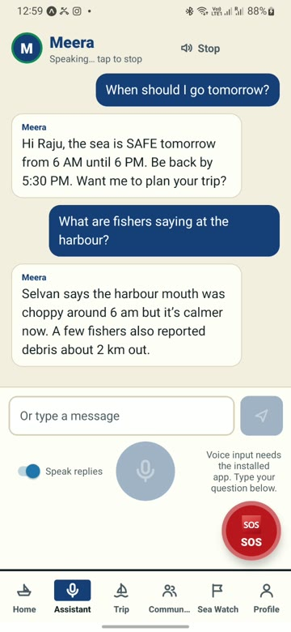
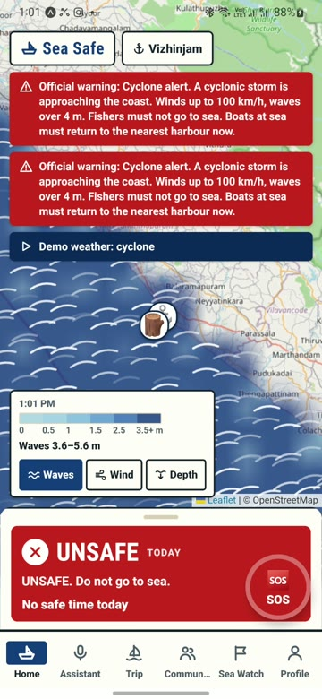
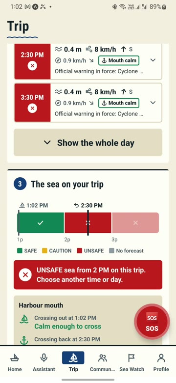
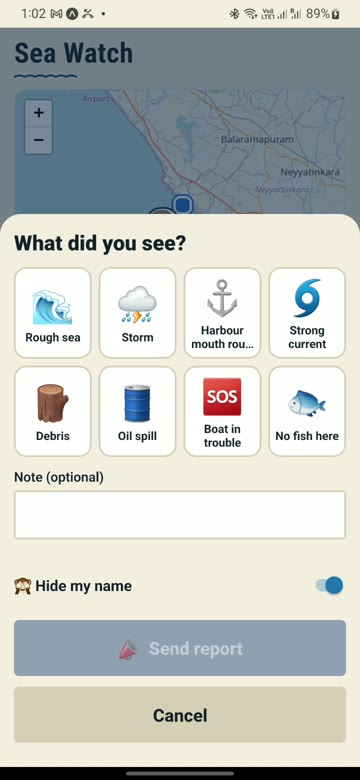
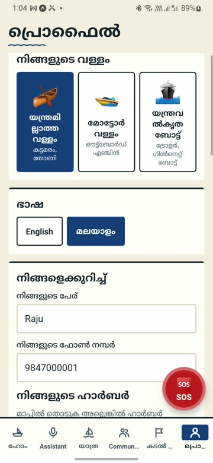
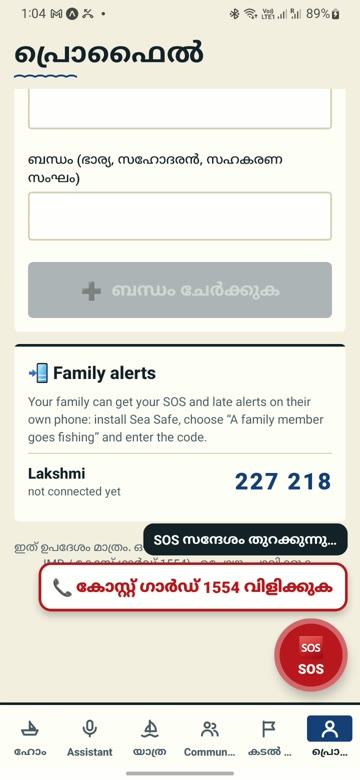

# Sea Safe

**An AI sea-safety assistant for small-boat fishers.** Ask “Is it safe to go to sea today?” in Malayalam or English and get a clear **SAFE / CAUTION / UNSAFE** answer, spoken aloud, for *your* boat and *your* harbour. Then Sea Safe watches the trip and raises the alarm if you don’t come home.

Built for **NOVA 2026** (24-hour hackathon). The pilot area is Vizhinjam, Kerala.

**For judges:** [GitHub repo](https://github.com/f20230198-art/NOVO) · [pitch deck](https://claude.ai/artifact/TCBmfuVeTrQAE8UUxU1WXy) · [demo video](docs/demo/sea-safe-demo.mp4) · [setup](#setup-about-10-minutes)

> **How to run it:** Sea Safe is a working prototype that runs in **[Expo Go](https://expo.dev/go)** on an Android phone, with the backend on a laptop. There is no APK to install: follow the [setup](#setup-about-10-minutes) below. The same code can be packaged as an installable APK for production; see [From prototype to APK](#from-prototype-to-apk).

---

## Why it exists

Small-scale fishers decide every morning whether to go out, often with no reliable information:

- **Warnings don’t reach them.** Official bulletins are long, in English, and don’t give a clear yes or no for one harbour on one morning.
- **Nobody notices when they’re late.** When a boat doesn’t return, family on the shore raise the alarm hours later, with no last position.
- **What fishers see stays local.** Rough harbour mouths and hazards are seen by other fishers first, but there is no trusted way to share them.

## What it does

| Feature | What the fisher gets |
|---|---|
| **Go / no-go verdict** | SAFE, CAUTION or UNSAFE for their boat type, from live wave, wind and storm forecasts |
| **Voice assistant “Meera”** | Ask in Malayalam or English and she answers out loud. Hour-by-hour advice (“go 5–11, avoid after 2”) and she can book the trip for you. In Expo Go you type the question; speaking it needs a native build |
| **Trip watch + automatic SOS** | If you’re overdue, Sea Safe asks “Are you back?”, then alerts family and buddy boats with your last position and asks them to call the Coast Guard (1554). Sea Safe does not contact the Coast Guard itself |
| **SOS without our server** | Hold the button for 2 seconds: the phone’s SMS app opens addressed to your contacts with your position, ready to send, even if our server is down. It needs a phone signal (not mobile data) |
| **Drift search zone** | Uses current and wind to show where a missing boat probably is now, and in +1, +3 and +6 hours |
| **Harbour-mouth check** | Estimates breaking waves at the harbour mouth, the most dangerous part of a small-boat trip |
| **Sea map** | Waves, wind and depth on a map, with a legend in metres |
| **Community** | Hazard reports, harbour chat and events. A report only counts once another fisher confirms it |
| **Family app + Ask by SMS** | Family members get alerts on their own phone; phones without data can ask by SMS (needs a Twilio number; so far only tried with the dashboard’s SMS simulator) |

## Screenshots

Recorded on a Samsung Galaxy M31 (Android 12) at Vizhinjam, Kerala. Full 3-minute demo video: [docs/demo/sea-safe-demo.mp4](docs/demo/sea-safe-demo.mp4).

| Sign up | Sea map + verdict | Harbour mouth + sea now |
|---|---|---|
|  |  |  |
| **Meera assistant** | **Cyclone: UNSAFE** | **Trip planner** |
|  |  |  |
| **Hazard report** | **Malayalam UI** | **SOS + Coast Guard call** |
|  |  |  |

### Safety rules we never break

1. **Rules decide, AI explains.** A tested rule engine sets the verdict (`backend/app/services/risk_engine.py`). The AI only puts it into words and can never change it.
2. **Unknown is never SAFE.** Missing or stale forecasts give CAUTION at best.
3. **Warnings only raise the risk.** Official warnings and confirmed reports can only make a verdict stricter, never more relaxed.
4. **Everything works with no API keys.** If keys are missing, answers come from templates and alerts are shown as `simulated`. The demo does not depend on any key.

## How it works

```
Open-Meteo forecasts ─┐
Official warnings ────┼─▶  Risk engine (pure rules)  ─▶  AI explains (optional)  ─▶  App · SMS · Family · Dashboard
Fisher reports ───────┘        SAFE / CAUTION / UNSAFE
```

| Part | Tech |
|---|---|
| `backend/` | Python 3.13, FastAPI, SQLModel (SQLite, or Postgres), Groq/Gemini key pool, 214 tests |
| `mobile/` | React Native + Expo (TypeScript). Speech recognition and text-to-speech run on the phone |
| `dashboard/` | One web page for the fishers’ co-op, served by the backend at `/dashboard` |
| Weather | Open-Meteo Marine + Forecast, which are free and need no key |

---

## Setup (about 10 minutes)

**You need:**
- A Windows laptop with [Git](https://git-scm.com/downloads), [Python 3.13](https://www.python.org/downloads/) and [Node.js 18+](https://nodejs.org/).
- An Android phone with the latest **[Expo Go](https://play.google.com/store/apps/details?id=host.exp.exponent)** from the Play Store (the app uses Expo SDK 58).
- The phone and the laptop on the **same Wi-Fi** (or a USB cable, see the alternative below).

### 1. Get the code

```powershell
git clone https://github.com/f20230198-art/NOVO.git
cd NOVO
```

### 2. Start the backend

From the `NOVO` folder, in PowerShell:

```powershell
powershell -ExecutionPolicy Bypass -File .\start-demo.ps1 -Seed
```

This sets up Python on the first run, loads demo data (`-Seed`) and **prints the address your phone needs**, for example `http://192.168.1.20:8001`. Leave it running.

> If the phone can’t connect, run it once as **Administrator** so it can open the firewall port.

### 3. Open the dashboard (optional)

Go to **http://localhost:8001/dashboard**. The admin key is `change-me`.

### 4. Start the app in Expo Go

In a **second** PowerShell window, from the `NOVO` folder:

```powershell
cd mobile
npm install
copy .env.example .env      # then open .env and set EXPO_PUBLIC_API_URL to the address from step 2
npx expo start --go
```

Open **Expo Go** on the phone and scan the QR code shown in the terminal. The first load takes a minute while the app bundles.

> If the app says it can’t reach the server, set the address on the phone: **Server settings** on the first screen (or long-press the title on Home → Simulation → Server settings).

**What works in Expo Go:** everything in the demo below, except two things that need native code Expo Go doesn’t include:
- **Voice input.** Type your question instead; Meera still answers out loud.
- **Phone notifications.** Head-back and overdue alerts show as in-app banners instead.

### Alternative: phone on a USB cable (no shared Wi-Fi needed)

This is how the demo video was recorded. Needs the Android SDK platform-tools (`adb`) and **Developer options → USB debugging** on the phone.

```powershell
adb devices                       # the phone should be listed as "device"
adb reverse tcp:8001 tcp:8001     # phone's 127.0.0.1:8001 -> laptop backend
adb reverse tcp:8081 tcp:8081     # phone's 127.0.0.1:8081 -> Metro bundler
cd mobile
$env:EXPO_PUBLIC_API_URL = "http://127.0.0.1:8001"
npx expo start --go --localhost
adb shell am start -a android.intent.action.VIEW -d "exp://127.0.0.1:8081" host.exp.exponent
```

### Optional: AI keys

Copy `backend/.env.example` to `backend/.env` and add one or more `GROQ_API_KEY` or `GEMINI_API_KEY` values for natural AI answers. **Everything works without them.**

### Useful commands

| What | Command |
|---|---|
| Backend tests | `cd backend && .venv\Scripts\pytest -q` |
| App type check | `cd mobile && npx tsc --noEmit` |
| Run backend by hand | `cd backend && .venv\Scripts\uvicorn app.main:app --reload --host 0.0.0.0 --port 8001` |
| App lint | `cd mobile && npx expo lint` |

### From prototype to APK

For the hackathon the app runs in Expo Go. Nothing in it is tied to Expo Go: it is a standard Expo (React Native) project with an `eas.json` already set up, so turning it into an installable, production-grade APK or Play Store build is a packaging step, not a rewrite:

- `eas build -p android --profile preview` (Expo’s cloud build) produces an installable APK; `--profile production` produces a Play Store bundle.
- A native build also enables what Expo Go can’t run: on-phone voice input in Malayalam and English, and local alarms (head-back, “are you back?”) that ring even with no signal.
- For a real release you would add a signing key, push notifications through Firebase, an HTTPS backend instead of the laptop on Wi-Fi, and a native-speaker review of the Malayalam text.

We have not built or tested an APK yet.

---

## 5-minute demo

**Before you start:** the backend is running with `-Seed`, the dashboard is on the projector, and the phones are on the same Wi-Fi.

**Simulation menu:** on the fisher phone, **long-press the “Sea Safe” title** on Home. From there you can change the weather (calm, rough, thunderstorm, cyclone…), post official warnings, fast-forward a trip or reset everything.

1. **Sign up.** Pick മലയാളം, enter a name, choose the boat with no engine, tap the **Muthalapozhi** harbour, and add one contact.
2. **Ask.** Open Meera and type “നാളെ രാവിലെ കടലിൽ പോകാമോ?” (“Can I go to sea tomorrow morning?”). In a native build you would hold the mic and say it. Meera answers out loud. Tap **എന്തുകൊണ്ട്?** (“Why?”) to see the numbers.
3. **Change the boat.** Pick the mechanised boat in Profile. In a **Rough sea** the verdict goes from UNSAFE to SAFE, because bigger boats can handle more.
4. **Storm.** Simulation → **Cyclone**. The home card turns red and Meera explains why.
5. **Overdue.** Choose **Calm**, start a trip, then Simulation → **Fast-forward my trip**. Within a minute the phone asks “Are you back?”. If nobody answers, the family phone gets an alert 5 to 30 minutes later (at once in an UNSAFE sea). These delays are deliberate and are not shortened for the demo.
6. **Lost at sea.** Simulation → **Lost at sea, no signal**. On the next monitor pass (up to a minute) an automatic SOS with the last known position is raised, and the dashboard shows the **drift search zone**. Without SMS keys it reaches only a linked family phone and is shown as `simulated` in the alert feed.
7. **Community.** On a second phone, report a rough harbour mouth. It only affects the verdict after another fisher confirms it.
8. **SOS.** Hold the red button for 2 seconds. An SMS with your position opens, ready to send, even with the backend switched off.

**Family phone:** on the first screen choose **“A family member goes fishing”**, then enter the 6-digit code from the fisher’s **Profile → Family alerts**.

---

## Project status

- Done: Backend: 214 tests passing.
- Done: App: type check and lint are clean.
- Done: Voice assistant: English and Malayalam.
- Done: Tested on a real phone (Galaxy M31, Expo Go): sign-up, map, Meera, cyclone simulation, trip planner, reports, Malayalam, SOS.
- Open: Runs in Expo Go; not yet packaged as an APK (see [From prototype to APK](#from-prototype-to-apk)). Voice input and phone notifications need that native build.
- Open: Contact phone numbers accept letters; validate the field so the SOS SMS always has a valid recipient.
- Open: The Malayalam text needs a native speaker to check it.
- Open: Twilio SMS, Telegram and push notifications have not been tried with real keys; they run as `simulated`.

## More docs

- [SEA-SAFE-PLAN.md](SEA-SAFE-PLAN.md): product spec and priorities
- [CLAUDE.md](CLAUDE.md): design rules and conventions for contributors
- [backend/README.md](backend/README.md) · [mobile/README.md](mobile/README.md)
